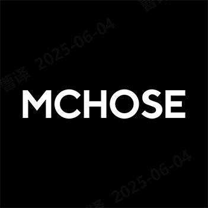
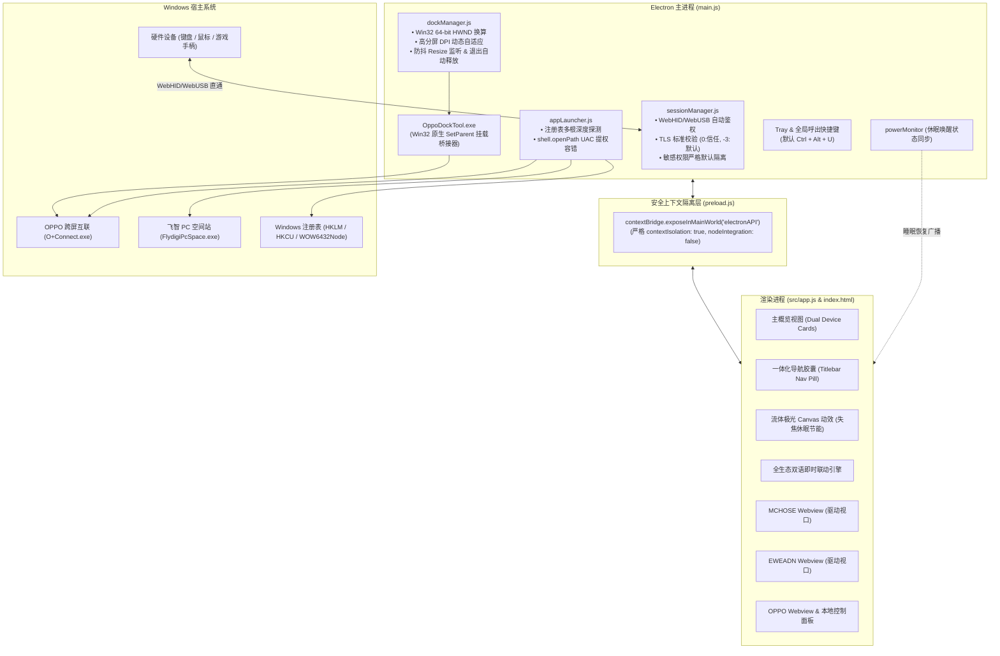
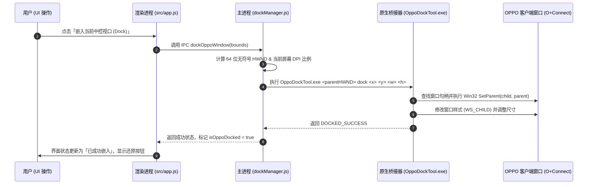

# UniControl


## 📖 项目简介

### 1. 为什么开发 UniControl？
随着现代桌面外设的多样化，机械键盘、轻量化鼠标、专业电竞手柄以及跨屏互联工具往往由不同的品牌硬件厂商提供，长期存在以下痛点：
- **入口极度割裂**：迈从、前行者等键鼠品牌全面转向了云端网页驱动（WebHID / WebUSB）；飞智游戏手柄依赖独立本地空间站客户端；OPPO 跨屏互联又包含网页端工作台与本地客户端；
- **系统资源浪费与托盘凌乱**：多套外设后台驱动常驻于系统托盘，进程冗余、内存消耗高且互相切换操作繁琐；

### 2. 解决方案
**UniControl** 通过 Electron 容器级隔离架构、Win32 原生句柄挂载（SetParent）与 WebHID 直通鉴权，将分散的多生态驱动聚合为一个优雅、高帧率、低功耗的统一控制台。

---

## 🧩 支持的品牌生态

<div align="center">

| 品牌生态 | 官方徽标 | 设备品类 | 驱动接入方式 | 核心特性支持 |
| :--- | :---: | :---: | :---: | :--- |
| **迈从 (MCHOSE)** |  | 键盘 / 鼠标 | `WebHID / WebUSB` | 官方云 Hub 自动授权直通、DPI/按键映射/宏配置、多节点故障智能容错切换 |
| **前行者 (EWEADN)** |  | 键盘 / 鼠标 | `WebHID / WebUSB` | 官方灯效管理、板载存储配置、音乐律动同步、双节点自动备用容灾 |
| **OPPO 随身工作台** |  | 手机 / 平板跨屏互联 | `Win32 Docking / Cloud` | **免安装云端工作台** 与 **本地客户端原生无缝嵌入 (Dock)** 双模自由切换 |
| **飞智 (FLYDIGI)** |  | 手柄(仅适配黑武士2Pro) | `Smart Path Launcher` | 全局注册表智能探测、UAC 提权容错拉起、托盘静默拉起与后台协同 |

</div>

---

## ✨ 核心功能亮点

### 1. ⌨️ 外设 WebHID / WebUSB 零弹窗自动鉴权
- **精准白名单直通**：仅对受信官方外设域名（`mchose.com.cn`, `eweadn.cn`, `heytap.com` 等）放行底层设备访问与跨源 Frame 嵌套；
- **最小权限隔离**：默认严格拒绝摄像头、麦克风、剪贴板等高危权限，杜绝恶意内嵌脚本滥用隐私；
- **热插拔即时感知**：硬件设备插拔时由主进程自动向渲染层分发事件，展示拟物液态毛玻璃 Toast 提醒。

### 2. 📱 OPPO 随身工作台「双模引擎」与 Win32 原生 Docking
- **云端免安装模式**：内置官方 HeyTap 云端工作台视口，无需在电脑上预装客户端即可管理多端协同；
- **本地客户端无缝嵌入 (Docking)**：借助配套原生工具 `OppoDockTool.exe`，通过 64 位无符号 HWND 句柄调用 Windows API，将官方「OPPO 跨屏互联」窗体原生无缝挂载在中控主视口中；
- **高分屏 DPI 自适应**：多显示器切换或窗口 Resize 时自动根据当前屏幕缩放系数（ScaleFactor）动态换算物理像素，防抖自适应排版；退出应用时自动安全 Undock 恢复独立窗口。

### 3. 🎮 飞智电竞手柄空间站一键拉起
- **多根注册表智能探测**：依次扫描 `HKLM`、`HKCU`、`WOW6432Node` 等标准与用户级卸载键，并深度探测常见 Program Files 路径；
- **UAC 提权安全兼容**：优先调用 `shell.openPath` 托管执行，彻底避免因权限不足引发的 `740 (ERROR_ELEVATION_REQUIRED)` 崩溃，未安装时提供直观指引。

### 4. 🍎 Apple Liquid Glass 液态毛玻璃设计语言
- **高阶光学拟物**：基于多层高斯柔光模糊（`backdrop-filter`）、微高光内描边与极细拟物投影；
- **动态极光光幕粒子**：自研轻量 Canvas 动态光斑系统，暗色呈现赛博霓虹蓝紫，亮色模式呈现极纯净白羽光；
- **智能休眠节能降耗**：当窗口失去焦点、最小化或用户在全屏游戏时，**自动挂起 Canvas 动画调度**，重新聚焦时瞬时唤醒 60fps，有效降低独显/核显功耗与笔记本发热。

### 5. 🖱️ 三级交互与硬件侧键防抖导航
- **全局后退分级**：三级确认弹窗 $\rightarrow$ 仅关闭三级返回设置；二级设置面板 $\rightarrow$ 仅关闭设置返回驱动；驱动视口 $\rightarrow$ 网页内后退（无历史记录时平滑返回主页）；
- **鼠标侧键穿透捕获**：在 Webview 各生命周期动态注入原生事件捕获，结合主进程 `app-command` 广播与 200ms 全局防抖锁，保证侧键、Esc 键与顶栏返回胶囊体验高度统一。

### 6. 🌐 全生态中英双语即时切换 (
- 简体中文 (`zh-CN`) 与 English (`en-US`) 一键无缝热切换；
- 语言状态不仅作用于中控 UI，还会向内置的各官方驱动 Webview 底层同步分发 `localStorage` 语言指令与国际化切换探针。

### 7. 🔔 增强型系统托盘与离屏防丢机制
- **托盘生态直达菜单**：右键系统托盘可直接一步打开迈从、前行者、OPPO 随身工作台或飞智空间站；
- **离屏防丢保护**：当断开外部扩展显示器时，自动检测窗口坐标并在当前工作区内居中重置，彻底杜绝“隐形窗口”。

---

## 🏗️ 系统架构与工作原理解析

### 1. 系统整体拓扑图



---

### 2. OPPO 随身工作台 Win32 原生 Docking 原理



---

## 🎨 UI/UX 设计语言与动效体系

UniControl 遵循 Apple macOS Sequoia 与 VisionOS 流体光影设计规范：

```
┌────────────────────────────────────────────────────────────────────────┐
│  🔴 🟡 🟢   [ UniControl | 一体化导航胶囊 ]        [WebHID]  [-] 100% [+]  🔄  ⚙️  │
├────────────────────────────────────────────────────────────────────────┤
│                                                                        │
│                      UniControl 控制中心                               │
│                                                                        │
│   ┌─────────────────────┐   ┌─────────────────────┐                    │
│   │   迈从 (MCHOSE)     │   │   前行者 (EWEADN)   │                    │
│   │   键鼠云端驱动中心   │   │   灯效与宏配置中心   │                    │
│   │         [ → ]       │   │         [ → ]       │                    │
│   └─────────────────────┘   └─────────────────────┘                    │
│                                                                        │
│   ┌─────────────────────┐   ┌─────────────────────┐                    │
│   │   OPPO 随身工作台   │   │   飞智 (FLYDIGI)    │                    │
│   │  [云端]  [本地跨屏] │   │   电竞手柄空间站     │                    │
│   └─────────────────────┘   └─────────────────────┘                    │
│                                                                        │
│                     动态 Canvas 极光微光流体层                          │
└────────────────────────────────────────────────────────────────────────┘
```

1. **红黄绿三色原生窗口控制**：左上角集成 macOS 标准窗体控制按钮，悬停呈现柔和微光图标；
2. **顶栏空间动态替换规范**：进入设备视口时，居中区域平滑变换为 **一体化导航胶囊** `[ ← 返回 | 🔄 刷新 | 品牌徽标 品牌名 ]`，坚决不遮挡官方驱动界面的核心控制区；
3. **滚轮无级缩放引擎 (Zoom Engine)**：鼠标悬停在缩放胶囊直接滚轮调节（`0.6x ~ 1.6x`）；在界面任意处按住 **`Ctrl` + 滚轮** 全局平滑自适应缩放；点击百分比文字一键重置 100%；
4. **液态反光与触觉跟随**：设备卡片跟随光标位置实时计算法线反射角度，点击伴随轻微回弹（Active Spring）。

---

## ⌨️ 快捷键与交互速查表

| 按键 / 组合键 | 触发位置 | 功能描述 |
| :--- | :--- | :--- |
| **`鼠标后退键` (Button 4)** | 全局任意位置 / Webview 内 | 智能层级回退：三级弹窗 $\rightarrow$ 二级设置 $\rightarrow$ 网页上一页 $\rightarrow$ 主概览 |
| **`鼠标前进键` (Button 5)** | 驱动视口内部 | 驱动网页前进下一页 |
| **`Escape` (Esc)** | 全局任意位置 | 快速退出三级弹窗、关闭二级设置或退出当前驱动返回概览 |
| **`Ctrl` + `Alt` + `U`** | Windows 全局系统后台 | 随时瞬时唤醒 / 隐藏 UniControl 主窗口（可在设置中自定义任意键位） |
| **`Ctrl` + `鼠标滚轮`** | 全局任意位置 | 全局界面无级平滑缩放（`0.6x ~ 1.6x`） |
| **`滚轮滑动`** | 顶栏缩放胶囊区域 | 直接快速调节当前缩放比例 |
| **`Ctrl` + `+` / `Ctrl` + `-`** | 全局任意位置 | 以 10% 步长放大或缩小界面 |
| **`Ctrl` + `0`** | 全局任意位置 | 立即重置缩放为 100% |
| **`Ctrl` + `R`** | 全局任意位置 | 刷新当前视图或重载驱动页面 |
| **`Ctrl` + `,` / `Ctrl` + `P`** | 全局任意位置 | 打开 / 关闭通用设置面板 |
| **`F12`** | 全局任意位置 | 打开 / 关闭 Chromium 开发者调试工具 |

---

## 📁 项目目录结构

```
UniControl/
├── locales/                        # Chromium 多国语言资源包
├── resources/
│   └── app/                        # 运行环境就绪副本 (通过 sync_build.ps1 镜像同步)
├── src/
│   ├── assets/                     # 品牌徽标与图标资源
│   │   ├── icon.png / icon.ico     # UniControl 原生主图标
│   │   ├── mchose-logo.png         # 迈从官方徽标
│   │   ├── eweadn-logo.png         # 前行者官方徽标
│   │   ├── oppo-logo.png           # OPPO 随身工作台徽标
│   │   └── flydigi-logo.png        # 飞智游戏手柄徽标
│   ├── main/                       # 主进程解耦核心模块
│   │   ├── sessionManager.js       # WebHID/WebUSB 鉴权、TLS 校验与权限策略
│   │   ├── dockManager.js          # Win32 原生挂载、DPI 换算与生命周期回收
│   │   └── appLauncher.js          # 多根注册表扫描与 UAC 提权唤起器
│   ├── styles/
│   │   └── main.css                # Apple 流体毛玻璃设计系统与响应式布局
│   ├── app.js                      # 渲染进程核心交互、Canvas 动效与 i18n
│   └── index.html                  # 统一工作台主结构
├── .gitignore                      # Git 忽略配置
├── DEV_HANDOVER_NOTES.md           # 架构备忘与排查修复交接手册
├── main.js                         # Electron 主进程主入口与全局生命周期
├── OppoDockTool.exe                # Win32 SetParent 原生挂载辅助工具
├── package.json                    # 工程元信息与脚本指令
├── preload.js                      # ContextBridge 安全隔离通信桥
├── README.md                       # 项目全景说明文档 (本文件)
├── sync_build.ps1                  # 自动化静态语法校验与双副本构建同步脚本
├── UniControl.exe                  # 宿主 Electron 可执行引导程序
└── UniControl_Setup.iss            # Inno Setup 独立安装包打包配置
```

---

## 🚀 快速上手与运行

### 1. 环境准备
- **操作系统**：Windows 10 / Windows 11 (x64)
- **Node.js**：`>= 18.0.0`
- **PowerShell**：Windows 自带的 PowerShell 5.1 或 PowerShell 7+

### 2. 安装与运行
```powershell
# 1. 克隆代码仓库
git clone https://github.com/your-username/UniControl.git
cd UniControl

# 2. 静态语法校验并同步运行环境副本 (推荐修改任何代码后执行)
npm run sync

# 3. 启动控制台
npm start
```

> [!TIP]
> **双副本机制说明**：
> 本工程采用「源代码根目录」与「`resources/app` 运行环境」镜像同步机制。双击根目录 `UniControl.exe` 或运行快捷方式时，Electron 默认加载 `resources/app`。
> 每次修改源码后，仅需运行 `npm run sync` 或执行 `./sync_build.ps1`，脚本将在 **1 秒内** 自动完成全量脚本语法校验、增量文件同步与运行副本二次验证。

---

## 🔒 安全与隐私加固规范

UniControl 严格遵循 Chromium 与 Electron 生产级安全标准：

1. **TLS 证书标准校验**：遵循严格的标准证书链，仅对 `localhost / 127.0.0.1` 本地驱动桥接精准豁免，彻底杜绝全局忽略 SSL 引发的中间人（MITM）攻击隐患；
2. **最小权限与来源校验**：仅对受信白名单域名放行 WebHID/WebUSB 自动配对；摄像头、麦克风、系统通知与剪贴板读取默认全面拦截；
3. **沙盒化外链隔离**：驱动网页中点击的任意第三方链接（如官方商城、售后协议等），均由主进程拦截并调用 Windows 默认浏览器打开（`shell.openExternal`），防止 Electron 容器内部弹出不受控窗口；
4. **防关机卡死机制**：在主进程 `before-quit` 生命周期中提前释放 Dock 句柄并放行窗口销毁，绝不阻止 Windows 系统的正常关机与注销。

---

## ❓ 常见问题与故障排查 (FAQ)

<details>
<summary><b>Q1: 为什么进入迈从或前行者驱动后显示未检测到设备？</b></summary>
<br/>
1. 请确保键盘或鼠标已通过有线连接或 2.4G 接收器与电脑连接（蓝牙连接由于系统限制通常不支持 WebHID 全功能写入）；<br/>
2. 如果设备仍未识别，请在右上角「设置」中点击「清理驱动缓存」，然后重新拔插接收器并刷新视口。
</details>

<details>
<summary><b>Q2: 使用「OPPO 本地跨屏互联」模式时提示未检测到窗口？</b></summary>
<br/>
Win32 原生嵌入（Docking）需要本地已启动官方客户端。请先在 UniControl 中点击「唤起客户端」，待任务栏出现 OPPO 跨屏互联程序后，再点击「嵌入当前中控视口 (Dock)」即可。若安装目录特殊，可在设置中手动配置 <code>O+Connect.exe</code> 路径。
</details>

<details>
<summary><b>Q3: 全局唤醒快捷键与其他软件冲突如何处理？</b></summary>
<br/>
点击右上角「设置」图标，找到「后台呼出快捷键」一栏，点击录制按钮后直接在键盘上按下你期望的按键组合（如 <code>Ctrl + Shift + U</code> 或 <code>Alt + F1</code>），系统将自动进行全局注册与持久化。
</details>

<details>
<summary><b>Q4: 笔记本在外出使用时如何进一步降低能耗？</b></summary>
<br/>
UniControl 已内置失焦节能机制。当窗口最小化或处于后台时，动态 Canvas 动效会自动挂起，几乎不消耗 GPU/CPU。如无需后台唤醒，亦可在设置中关闭「关闭主窗口时后台运行」。
</details>

---

## 📄 开源许可证

本项目基于 [MIT License](LICENSE) 协议开源分发。

```text
Copyright (c) 2026 UniControl Team

Permission is hereby granted, free of charge, to any person obtaining a copy
of this software and associated documentation files (the "Software"), to deal
in the Software without restriction, including without limitation the rights
to use, copy, modify, merge, publish, distribute, sublicense, and/or sell
copies of the Software, and to permit persons to whom the Software is
furnished to do so, subject to the following conditions:
...
```

<div align="center">

**UniControl · 让外设控制回归极简与优雅**

*Made with ❤️ for MCHOSE, EWEADN, OPPO & FLYDIGI Users*

</div>
